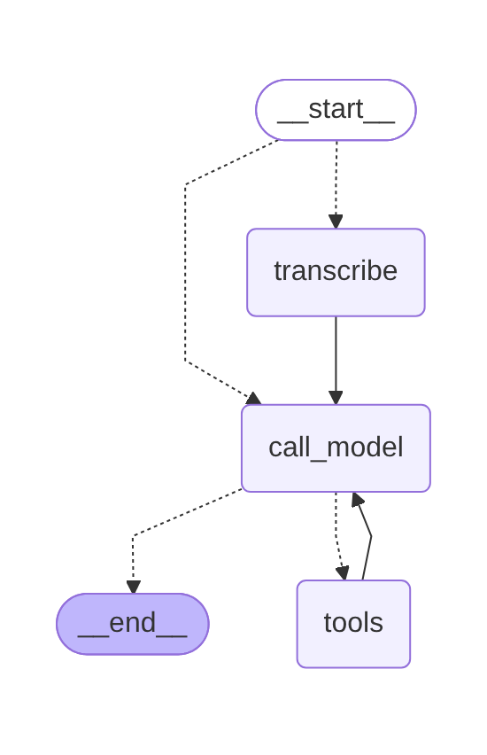

# mtg-bot

A Telegram assistant for **Magic: The Gathering**. Ask about a card or a mechanic by text or by voice.
It is a LangGraph agent running on a local LLM through Ollama, with real card data from the Scryfall API.

**Stack:** LangGraph · LangChain · Ollama · faster-whisper · aiogram · Scryfall API

## Features

- **Text and voice questions.** Voice messages are transcribed locally with faster-whisper.
- **Card lookup as a tool.** The model calls Scryfall's fuzzy search, so small typos in card names are fine.
  When there is no exact match, the bot suggests similar card names.
- **Conversation memory per chat** through a LangGraph checkpointer.
- **Runs locally.** The LLM and speech recognition run on your machine; at runtime only Telegram and Scryfall are contacted.
- **Resilient to network blips.** A failing tool call reaches the model as a message instead of crashing the graph,
  and the bot keeps retrying to connect to Telegram on start.

## How it works



The bot is a LangGraph `StateGraph` with a router and three nodes:

- `route_input` is a router on the edge from `START`: voice messages go to `transcribe`, text goes straight to `call_model`.
- `transcribe` turns the voice message into text with Whisper and adds it to the history as the user's message.
- `call_model` sends the system prompt and the chat history to the LLM. The model either answers or asks for the `search_card` tool.
- `tools` is LangGraph's prebuilt `ToolNode`. It runs the requested tool and hands the result back to `call_model`.

The `call_model ⇄ tools` loop is what makes it an agent: the model decides when to use the tool and when to stop.
`tools_condition` routes to `END` once the model's answer has no tool calls, and `recursion_limit` caps the loop.

The state (`BotState`) extends `MessagesState` with `audio_path`. New messages are appended to the history by a reducer,
while `audio_path` is simply overwritten and reset to `None` after transcription.

## Project structure

```
bot.py            Telegram layer (aiogram): turns messages into graph input and sends answers back
graph.py          The agent: state, router, nodes, the search_card tool and the graph itself
requirements.txt  Dependencies
.env.example      Configuration template
docs/graph.png    Graph diagram
```

## Requirements

- Python 3.10+ (tested on 3.12, macOS)
- [Ollama](https://ollama.com) with a model that supports tool calling (default: `qwen2.5:3b`)
- A Telegram bot token from [@BotFather](https://t.me/BotFather)

## Setup

```bash
git clone https://github.com/Vonzlov/mtg-bot.git
cd mtg-bot
python3 -m venv .venv
source .venv/bin/activate
pip install -r requirements.txt
cp .env.example .env
ollama pull qwen2.5:3b
```

Put your bot token into `.env` and start the bot:

```bash
python bot.py
```

On the first run, faster-whisper downloads the `small` Whisper model (about 0.5 GB) from Hugging Face.

## Configuration

| Variable | Description | Default |
|---|---|---|
| `TELEGRAM_BOT_TOKEN` | Bot token from @BotFather | required |
| `OLLAMA_MODEL` | Ollama model; it must support tool calling | `qwen2.5:3b` |
| `DEBUG` | `1` prints every graph step and everything sent to and received from the model | `0` |

To see the graph, print it as Mermaid and paste the output into [mermaid.live](https://mermaid.live):

```bash
python -c "from graph import graph; print(graph.get_graph().draw_mermaid())"
```

## Limitations

- Card data comes from Scryfall, but the explanation is written by a small local model and may be imprecise.
- Mechanics are answered from the model's own knowledge: there is no rules source yet, so these answers can be wrong.
- The search works with English card names. Heavily misspelled names may not be found.
- Voice messages are recognized in English.
- Conversation memory lives in RAM (`InMemorySaver`) and is lost on restart.
- `av` is pinned below 19, because faster-whisper 1.2.1 doesn't work with av 19.

## Roadmap

- RAG over the Magic: The Gathering Comprehensive Rules as a second tool for questions about mechanics
- Local fuzzy matching against Scryfall's full catalog of card names for better suggestions
- Card fields formatted in code, with the model writing only the explanation
- Persistent memory, for example with a SQLite checkpointer

## Acknowledgements

Card data is provided by the [Scryfall API](https://scryfall.com/docs/api). This project is not affiliated with Scryfall.

mtg-bot is unofficial Fan Content permitted under the Fan Content Policy. Not approved/endorsed by Wizards.
Portions of the materials used are property of Wizards of the Coast. ©Wizards of the Coast LLC.
